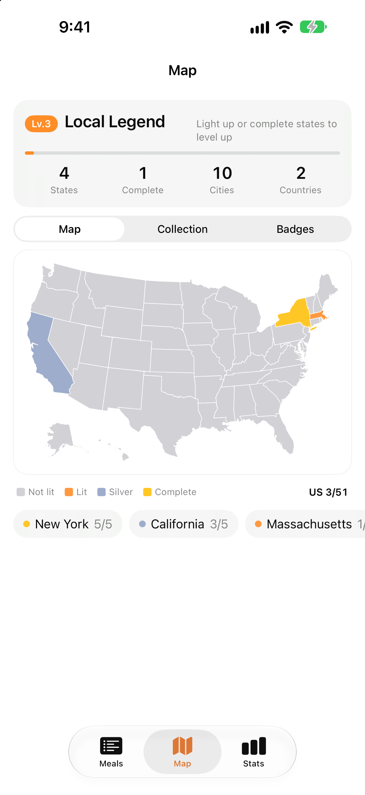
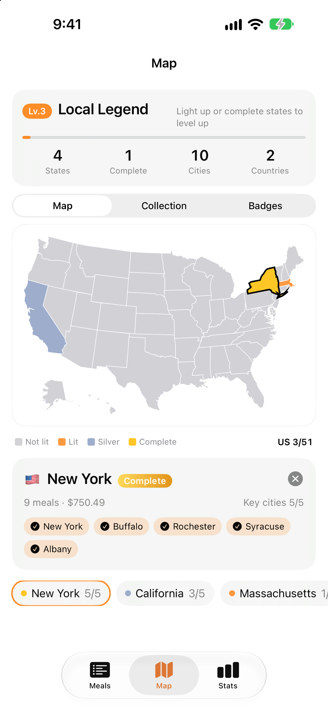
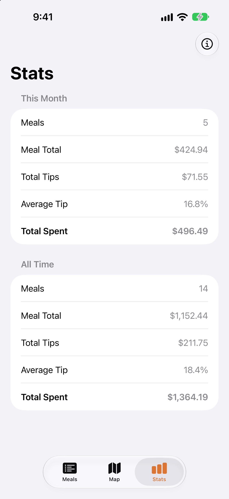

  

<h1 align="center">Meal Ledger</h1>

  Log every meal and tip, and light up the states you've eaten in.

  <a href="https://lyuzz.github.io/MealLedger/">Support</a> ·
  <a href="https://lyuzz.github.io/MealLedger/privacy.html">Privacy Policy</a>

---

## Features

- **Scan receipts** – snap a receipt or pick a photo to fill in the restaurant, date, meal cost and tip. Recognition runs entirely on your iPhone; photos are never uploaded.
- **Know your tipping** – one-tap tips at 15% / 18% / 20% / 25%, plus monthly and all-time spending, total tips and average tip percentage.
- **Light up your food map** – eat anywhere in a state and it lights up. Eat in half of its five key cities to go silver; eat in all five to complete the state and earn its badge.
- **Private by design** – everything stays on your iPhone. No account, no ads, no tracking.

Available in English and Simplified Chinese. Requires iOS 17 or later.

## Screenshots

  
  
  
  

## Contact

Questions or feedback: [zefenglyu2@gmail.com](mailto:zefenglyu2@gmail.com)

---

This repository hosts the app's support and privacy pages, served with GitHub Pages.
