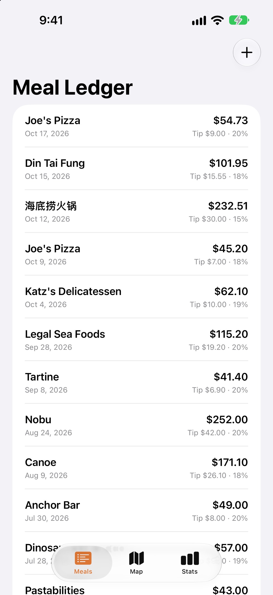

  

<h1 align="center">Meal Ledger · 饭钱账本</h1>

  Log every meal and tip, and light up the states you've eaten in. 
  记下每顿饭花了多少、小费给了多少，在地图上点亮你吃过的每一个州。

  <a href="https://lyuzz.github.io/MealLedger/">Support · 支持</a> ·
  <a href="https://lyuzz.github.io/MealLedger/privacy.html">Privacy Policy · 隐私政策</a>

---

## Features

- **Scan receipts** – snap a receipt or pick a photo to fill in the restaurant, date, meal cost and tip. Recognition runs entirely on your iPhone; photos are never uploaded.
- **Know your tipping** – one-tap tips at 15% / 18% / 20% / 25%, plus monthly and all-time spending, total tips and average tip percentage.
- **Light up your food map** – eat anywhere in a state and it lights up. Eat in half of its five key cities to go silver; eat in all five to complete the state and earn its badge.
- **Private by design** – everything stays on your iPhone. No account, no ads, no tracking.

Available in English and Simplified Chinese. Requires iOS 17 or later.

## 功能

- **拍小票，自动记账**：拍一下小票或从相册选一张，自动识别餐厅、日期、餐费和小费。识别完全在手机上完成，照片不会上传。
- **小费统计**：一键按 15% / 18% / 20% / 25% 算小费；本月和全部的餐费、小费、平均小费比例一目了然。
- **点亮美食足迹**：在一个州里任何地方吃过饭，这个州就会点亮；吃过一半代表城市升级为银色，吃遍 5 座代表城市就全通，获得专属州徽章。
- **隐私至上**：所有数据只保存在你的 iPhone 上，不需要注册账号，没有广告，不追踪你。

支持简体中文和英文，需要 iOS 17 或更高版本。

## Screenshots · 截图

  
  
  
  

## Contact · 联系

Questions or feedback: [zefenglyu2@gmail.com](mailto:zefenglyu2@gmail.com)

有问题或建议，请发邮件到 [zefenglyu2@gmail.com](mailto:zefenglyu2@gmail.com)。

---

This repository hosts the app's support and privacy pages (served with GitHub Pages).
本仓库存放 App 的支持页和隐私政策页，通过 GitHub Pages 发布。
